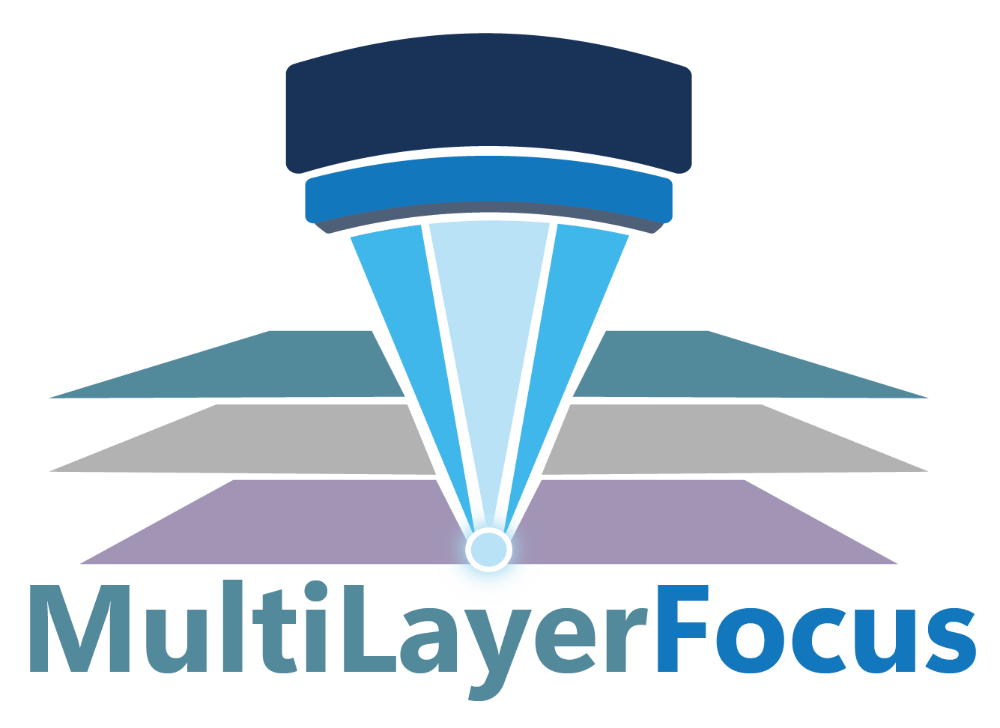

# MultiLayerFocus

<p align="center">
  
</p>

**A Python toolbox for vectorial focusing in stratified media**

MultiLayerFocus is a Python-based numerical toolbox for simulating high-numerical-aperture (NA) focusing in homogeneous and stratified optical media.

The software combines the vectorial **Debye–Wolf diffraction formalism** with a coherent **transfer-matrix approach** to model the propagation of tightly focused electromagnetic fields through planar multilayer structures.

It enables the reconstruction and analysis of the complex electric field before, inside, and after multilayer structures, accounting for polarization-dependent transmission, reflection, interference, and absorption.

MultiLayerFocus provides a graphical user interface (GUI) for configuring optical systems, performing numerical simulations, visualizing field distributions, and exporting results.

## Key Features

- **Vectorial high-NA focusing:** Numerical reconstruction of the three Cartesian electric-field components (Ex, Ey, Ez) using the Debye–Wolf formalism.
- **Multilayer optical structures:** Simulation of stratified dielectric and absorbing media using polarization-dependent transfer matrices.
- **Multiple reflections:** Coherent treatment of forward- and backward-propagating fields within finite layers.
- **Flexible pupil illumination:** Support for uniform, elliptical, circular, radial, azimuthal, and mixed cylindrical-vector polarization states.
- **Structured optical fields:** Configurable vortex phase and Zernike aberrations.
- **Custom pupil fields:** Import of externally generated or experimentally reconstructed complex pupil distributions.
- **Spatial field reconstruction:** Calculation of transverse XY fields, longitudinal XZ/YZ sections, and three-dimensional XYZ volumes.
- **Polarization analysis:** Visualization and characterization of the local three-dimensional polarization ellipse.
- **Graphical interface:** Interactive configuration, simulation, visualization, and export of numerical results.

## Scientific Background

High-NA focusing requires a vectorial description of electromagnetic propagation, particularly when the focal region contains refractive-index discontinuities.

MultiLayerFocus combines two complementary theoretical approaches:

1. **Debye–Wolf diffraction theory**, describing the coherent superposition of angular plane-wave components focused by a high-NA objective.

2. **Transfer-matrix methods**, describing reflection, transmission, and interference in planar stratified media.

The resulting framework provides the complex electromagnetic field throughout the optical structure, including the contributions associated with internal reflections and longitudinal polarization components.

The numerical model and its validation are discussed in the accompanying scientific publication.

## Installation and Execution

### Windows portable application

MultiLayerFocus is available as a portable Windows application.

Download the application distribution, extract it into a folder, and run:

`MultiLayerFocus.exe`

Keep the executable together with its accompanying application files and the `_internal` folder.

### Python graphical interface

When the Python package is installed in a compatible environment, the graphical interface can be launched using:

```bash
python -m stratified_focus.gui
```

For additional information, consult the GUI User Guide.

## Getting Started

A typical simulation consists of the following steps:

1. **Define the objective and illumination:** Set the numerical aperture, focal length, wavelength, pupil amplitude, and polarization state.

2. **Configure the multilayer:** Specify the refractive indices and thicknesses of the optical layers, ordered from the incident medium to the exit medium.

3. **Preview the configuration:** Use *Confirm configuration / preview inputs* to validate the optical parameters and inspect the multilayer geometry and pupil field.

4. **Set the observation region:** Define the spatial coordinates, observation window, and numerical sampling. Enable XZ, YZ, or XYZ calculations when required.

5. **Run the simulation:** Click *Run simulation* to calculate the vectorial electromagnetic field.

6. **Analyze and export results:** Inspect the field distributions and polarization properties, then save the numerical data or export a complete simulation session.

## Simulation Results

Depending on the selected configuration, MultiLayerFocus provides:

- Complex Cartesian electric-field components Ex, Ey, and Ez.
- Total and component-resolved electric-field intensity distributions.
- Transverse and longitudinal intensity maps.
- Three-dimensional electric-field intensity visualization.
- Spatially resolved polarization properties.
- Numerical data for further processing and analysis.

Simulation results can be saved as reloadable `.npz` files.

The *Export session* function can generate a complete simulation record containing a numerical snapshot, a PDF report, graphical outputs in PNG or TIFF format, and text data files.

## Documentation

Detailed instructions for configuring and operating MultiLayerFocus are provided in the **MultiLayerFocus GUI User Guide**.

The guide covers objective and illumination parameters, Zernike aberrations, external pupil-field import, multilayer configuration, numerical sampling, visualization tools, and result export.

## Applications

MultiLayerFocus can support numerical investigations in:

- High-resolution and vectorial microscopy.
- Optical trapping and optical manipulation.
- Structured light and polarization engineering.
- Focusing through dielectric and absorbing multilayers.
- Laser nanofabrication and direct laser writing.
- Optical field reconstruction and photonic simulations.

## Citation

**If you use MultiLayerFocus to obtain results presented in a scientific publication, you must cite the associated scientific article specified in the `CITATION.cff` file, as required by the software license.**

Please refer to `CITATION.cff` for the bibliographic information and the preferred citation.

## License

Copyright © 2026 [Authors' Full Names].

MultiLayerFocus is distributed under a custom non-commercial research license.

Academic and non-commercial scientific research use is permitted under the conditions described in the `LICENSE` file.

**Any use by or on behalf of commercial companies, including internal research and development, requires prior written authorization from the copyright holders.**

See the `LICENSE` file for the complete terms and conditions.

For commercial licensing requests, contact:

[Contact Email]

## Disclaimer

MultiLayerFocus is provided for scientific research purposes without warranty of any kind, subject to the terms of the accompanying license.
